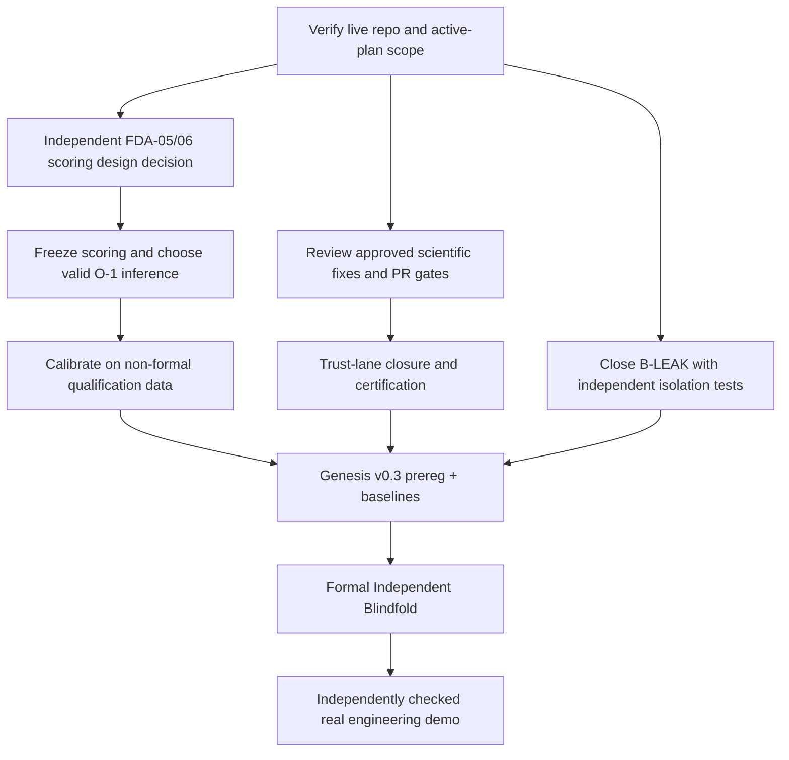

# FORGE — Pause / Resume Checkpoint (2026-10-19)

> **Purpose:** durable handoff for a deliberate work pause. The owner can later say **"كمل آخر حاجة"**, **"كمل شغل FORGE"**, or **"continue FORGE"** and the agent must reconstruct state, draw the status/roadmap table, and continue only with work that is already authorized.
>
> **STATUS AT AUTHORING:** OWNER_PAUSED. This document records a snapshot; it is **not** scientific evidence, certification, approval to merge, or a new execution queue.
>
> **Authority:** `CLAUDE.md` and `docs/work/ACTIVE_PLAN.md` remain binding. The latter is the **sole executable work queue**. `docs/project/FORGE_MASTER_PLAN.md` controls strategy; `docs/discovery/FORGE_GENESIS.md` controls Genesis science; mature/certification rules retain their original owners. This checkpoint cannot override any of them.

## 1. What FORGE is for

FORGE is a **solver-neutral scientific reasoning and trust layer**, NOT a universal physics solver. External providers compute; FORGE owns applicability, uncertainty, evidence admission, provenance, replay, scientific refusals and verdicts. Optional LLM agents propose, never issue scientific authority.

**North star:** (1) independent, leakage-resistant **Blindfold Graduation** against equal-budget strong baselines, plus (2) an **independently reviewed real engineering demo** demonstrating a grounded result or correct scientific refusal. Never claim either achieved without executed evidence.

Commercialization and business valuation are a separate track; do not substitute hypothetical valuation for measured technical maturity or sales.

## 2. Snapshot identity and provenance

This table describes information observed **on 2026-10-19**. Re-query GitHub and the local worktree before trusting it.

| Item | Checkpoint observation | Verification required on resume |
|---|---|---|
| Repository | `sharq-labs/forge` (private) | Confirm current GitHub repo and permissions |
| Default branch | `main` @ `a051af162647b20ab81bfbb99d0af0b533b32d11` | Fetch fresh HEAD; SHA here will become stale |
| PR #169 | `fix/p0-scientific-correctness-2026-10-18` @ `abed661f`; OPEN, **not merged**; review/OD-3 unresolved | Fetch live PR and checks; never assume merged or certified |
| PR #170 | `docs/deep-audit-evidence-2026-10-19` @ `2acf9da1`; **MERGED** | Verify on main and any follow-up correction |
| Scientific audited tree | `abed661f` (not necessarily current main) | Keep evidence scoped to the audited commit |
| Owner's previously used Windows worktree | `D:/forge-main-337519d1` | Verify path/branch/HEAD/status before touching; multiple agents may be active |
| Main evidence pointer | `docs/work/DEEP_SCIENTIFIC_DEFECT_AUDIT_2026_10_19.md` | Read on current main |
| Historical FDA evidence | `docs/work/evidence/deep_audit_2026_10_19/` | Never edit pinned historical bytes; manifest governs their identity |
| Pause/resume plan | This file + root `CLAUDE.md` pointer | Do not assume this draft PR was merged |

**Execution reminder:** FDA reproduction evidence was from Windows CPython 3.14.2, **not** the Linux 3.11/3.12 certification platform. Static source review is not executed validation. Do not re-run historical reproduction scripts automatically.

## 3. Verified or reported scientific state, NOT a maturity promotion

The following are **audit claims bound to `abed661f`**, not independently certified conclusions:

- **Deep FDA audit:** 26 defects: 6 MAJOR + 20 MINOR, plus 8 observations. Five findings were reproduced in **four** approved bounded runs (R-03..R-06); everything else has its stated, generally static evidence class. The audit classified zero new BLOCKER labels, which does **not** waive any scientific gate.
- **FDA-05 / Genesis scoring:** an `INDISTINGUISHABLE` pair can receive full credit for vacuous, widely diverging brackets. Reproduced at the pair-scoring level; a false *end-to-end lift PASS* has **not** been demonstrated.
- **FDA-06 / Genesis cap scope:** the candidate cap applies to `discoverable`, not all other law-credit kinds; the capping-function defect was reproduced; full lift flip is not established.
- **O-1 statistics:** a fraction of ordinary bootstrap resample means is used as a Holm p-value; validity/FWER in this setting is **UNVERIFIED**. Do not freeze, claim lift, or run formal Blindfold using an unqualified decision rule.
- **B-LEAK:** the previously observed same-account hidden-answer leakage is an existing **formal measurement blocker**; independent security isolation and evaluator separation remain necessary.
- **FDA-01 / replay:** certain uncertainty/validation outputs are not bound or compared by assembly replay; source-proven/static, not reproduced at runtime.
- **FDA-02 / state clock:** authority may commit a state disconnected from run start time; source-proven/static, not reproduced at runtime.
- **FDA-03 / materials:** contradictory source values can be silently selected and covered as known; reproduced.
- **FDA-04 and FDA-14 / MCP UQ:** degenerate sampling and incorrect claimed empirical interval coverage; reproduced.
- **D4 archive readback:** frozen current-format model cannot round-trip; scientific reach/contract disposition still requires owner decision. An export-only contract downgrade is not the same as repairing readback.
- **OD-29 internal FastSystem execution provenance**, cross-domain uncertainty BO4/BO9, various OD-22..34 scientific semantics and G0 dependency/global-scope question remain open unless later evidence closes them.
- **BVB-0:** 97 present components surveyed. Original classifications: KEEP 69, REPLACE 3, DEFER 4, AUDIT 21; proposed **not approved** FDA reconciliation moves A16/A21 from KEEP to AUDIT => KEEP 67, AUDIT 23. BVB is review, not installed/implemented modernization. PySR / BoTorch / grammar-search suggested only as independently qualified baseline arms, not Trust authority.
- **Commercial valuation discussion:** rough, *non-transactional* illustrative IP-sale range **USD 100k–500k**, central thought experiment **USD 250k**, conditional on ownership, technical due diligence and a buyer. **Not** an appraisal, offer, verified transaction price, ARR, or investor valuation. No verified paid revenue or customer contracts were presented here.

Never say that FDA bugs are fixed, O-1 validated, B-LEAK closed, formal Blindfold passed, certification current or the real engineering demo independently validated unless new executed evidence supports it.

## 4. Local-only work: safeguard before resumption

Previous agents reported uncommitted/untracked local `docs/work/` documents on the Windows worktree, including:

- `BVB_40_ALGORITHM_INVENTORY.md`, `BVB_SCIENTIFIC_COMPARISON_MATRIX.md`, `BVB_LICENSE_AND_DEPENDENCY_AUDIT.md`, `BVB_NUMERICAL_EQUIVALENCE_PLAN.md`, `BVB_PRE_BLINDFOLD_ROADMAP.md`, `BVB_OWNER_DECISIONS.md`.
- `BVB_FDA_RECONCILIATION_ADDENDUM.md`.
- `D4_ARCHIVE_COMPATIBILITY_DESIGN_REVIEW.md`, `GENESIS_STEP0_A1_READINESS_REVIEW.md`.
- `FDA_05_SCORING_CLOSURE_DESIGN.md`, `FDA_06_CAP_SCOPE_CLOSURE_DESIGN.md`, `GENESIS_SCORING_STATISTICAL_DEPENDENCIES.md`, `OWNER_DECISION_PACKAGE.md`, `GENESIS_SCORING_DESIGN_CHALLENGE.md`.
- Another agent reported a local `docs/work/evidence/fda_audit_2026_10_19/` copied preservation bundle; check for duplicated material against merged PR #170 before any commit.
- Historical evidence may also exist only in ignored scratch/test folders; do not clean or overwrite.

**These are last-reported filenames, not assertions they still exist or have been pushed.** On resume, compare to the live repo and locate them safely; preserve hashes and author ownership. Do not reset/stash/clean a shared worktree.

## 5. Immediate decision context when pausing

1. **Scientific scoring design unresolved.** An adversarial self-challenge found F5-A (hidden-rival-relative informativeness) vulnerable to sign-crossing, generator-shape copying, absent rival kinds and possible gaming of the width parameter. Proposed F5-IS interval scoring requires carefully defined probabilistic semantics; F5-D conservative fallback gives no excessive reward but may be uninformative. **No FDA-05 scoring algorithm has owner-approved final semantics.**
2. **FDA-06 design partly accepted as a direction, not approved implementation.** Cap law-credit kinds appropriately; distinguish expressibility from equal-budget attainability and avoid pilot-selection bias. BoTorch experiment selection should not automatically widen a law-search family.
3. **O-1** must be designed for the **eventual frozen scoring pipeline** with valid primary-null inference, strongest-baseline selection, non-inferiority, multiplicity and repeated-submission handling. No simulation approval as of this checkpoint.
4. **Independent design review was proposed** to Codex, but whether it actually ran is **unknown**. The Claude challenge was explicitly *not author-independent*. Do not silently treat it as independent external assurance.
5. **PR #169** remains open and needs independent review, required gates and owner-approved integration. **PR #170** preserved evidence but its reviewer P2 findings about register method metadata, fail-closed verifier and the 20-field claim, and its CI scope/classify failures, must be reconciled by checking newer commits/status (do not infer billing without evidence).
6. **Licensing:** Gmsh GPL/in-process integration and transitive PETSc/DOLFINx/Dakota licensing require technical and legal distribution review; no automatic compliance claim.
7. **No owner decision to merge, recertify, install new libraries, run new reproductions, conduct formal campaigns or alter preregistered scoring** is supplied by this checkpoint.

## 6. What to do when the owner says "كمل آخر حاجة"

**Mandatory interactive recovery protocol (READ/REPORT FIRST):**

1. Read `CLAUDE.md`, `docs/work/ACTIVE_PLAN.md`, `docs/work/PROGRESS.md`, `docs/project/FORGE_MASTER_PLAN.md`, this checkpoint, and Genesis contracts if involved.
2. Check actual current GitHub `main`, open PRs (especially #169), recent merges and CI, and the intended local worktree's `git status`; check for other running agents. If access is unavailable, mark **UNVERIFIED** and do not invent status.
3. Decide which tracked slice in `ACTIVE_PLAN.md` is active. This checkpoint is a **history/resume aid only**. If current authoritative docs or the owner have superseded it, use them and name the discrepancy.
4. **Always show the owner a newly generated Markdown STATUS TABLE before doing substantial work:**

   | # | Workstream / task | Last evidence & exact commit | State (DONE / OPEN / BLOCKED / UNVERIFIED) | Dependency / owner decision | Next bounded action | Priority ★ |
   |---|---|---|---|---|---|---|

   Include rows for current integration/assurance, FDA scientific defects, FDA-05/06 scoring, O-1 statistics, B-LEAK isolation, BVB, Genesis v0.3 and the real engineering demo, unless superseded. Do not assign **DONE** to design documents alone when execution is required.
5. **Draw a compact dependency roadmap** below the table (Mermaid or simple arrows), such as:

   `Scientific repairs + safe integration + certification` and `FDA-05/FDA-06 scoring + O-1 valid statistics + equal-budget baselines + B-LEAK isolation` → `Genesis v0.3 preregistration freeze` → `Independent Blindfold measurement` → `Real engineering demo and commercial validation`.

   This is a **conceptual map**, not a command to start all tracks or a replacement for the active-plan queue.
6. State: **last completed action**, **first genuinely unfinished action**, **known blockers**, **what can safely be done now**, **what requires explicit owner permission**, and **precise scope of the next small task**.
7. Then **continue only the smallest currently authorized work** from `ACTIVE_PLAN.md`. If the next action requires owner approval, ask for that single decision and stop there. No full assurance, expensive run, code edit, installer, benchmark, commit/push/PR/merge or certification is implicitly authorized by "continue".
8. After any owner-approved completed work, update the appropriate plan/progress records according to the existing governance; leave a fresh dated checkpoint with exact branch, SHA, evidence and next action **only if modification is authorized**.
9. When the owner instead asks only "الجدول" or "وصلنا لفين", output the status table and dependency roadmap **without executing anything**.
10. Write the user-facing table and explanation in **Egyptian Arabic**, retaining technical identifiers in English; use ★ rating for relative priority, not unmeasured scientific maturity or speedups.

### Starter diagram to refresh, never blindly reuse

## 7. Safety / truthfulness on resume

- No passive background work during owner pause, no implicit permission to run tests or agents.
- Source commits, timestamps, pass counts and owner decisions must be verified anew.
- NEVER modify original SHA-pinned historical evidence or silently re-score frozen pilots.
- Keep CERTIFIED / FUNCTIONAL / UNVERIFIED / FOUNDATION labels tied to explicit existing policy and evidence.
- Refusal and UNKNOWN are legitimate scientific outcomes, not failures to be hidden.
- Prioritize actual false-support/authority risks over feature count or hypothetical monetary value.
- If a new chat has no repository connector, ask to open this checkpoint or supply it; do not claim knowledge of current local files.

## 8. Short owner resume message

**Arabic:** `كمل آخر حاجة في FORGE. اقرأ CLAUDE.md و docs/work/PAUSE_RESUME_CHECKPOINT_2026_10_19.md و ACTIVE_PLAN.md، تحقق من GitHub والـworktree، اعرض جدول الحالة والأولويات وخريطة الاعتماديات، وبعدها نفّذ فقط أول خطوة مصرح بها.`

**English:** `Resume FORGE from the persistent checkpoint, verify current repository state, draw the status/priority/dependency table, and continue the next already-authorized bounded task only.`

---
Checkpoint authored 2026-10-19. Historical snapshot; subject to live verification.
