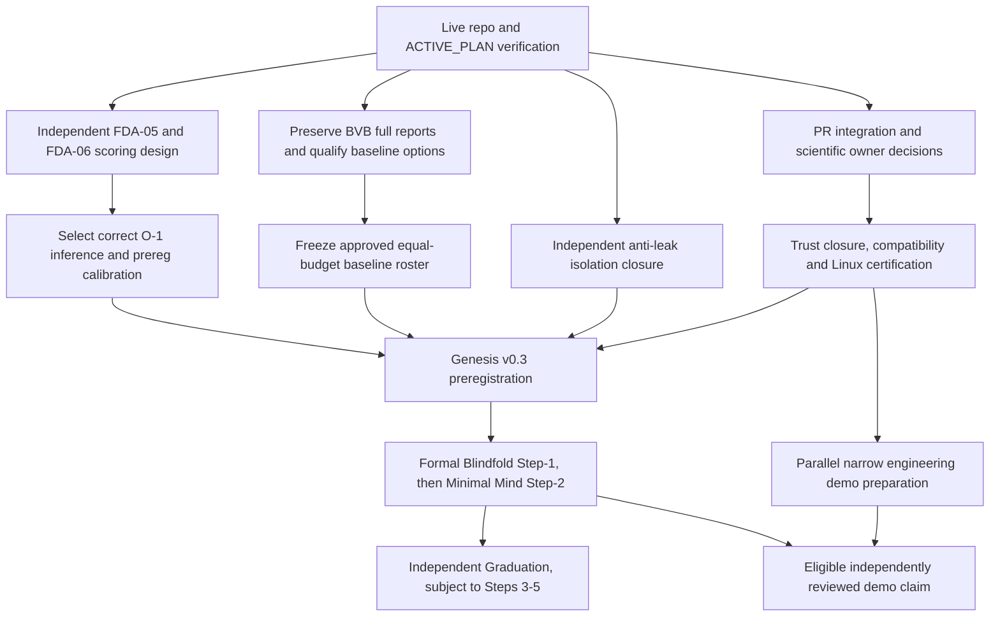

# FORGE — Resume Dashboard (snapshot 2026-10-19)

> **READ ME FIRST after a pause.** This is a navigation and prioritization **snapshot**, not a new task queue, certification, authorization, or replacement for `docs/work/ACTIVE_PLAN.md`. Rebuild all statuses from live repository evidence each time. The original source for the audit was **`abed661f`**, not necessarily `main`.
>
> **Pause state:** owner taking a break; no background tasks, scheduled jobs, implicit test runs, merges or expensive simulations.

## Authority and reading order

1. `CLAUDE.md` (scientific and engineering rules) + [AI Context Map](../ai/CONTEXT_MAP.md) (what to read selectively).
2. `docs/work/ACTIVE_PLAN.md` (the **only executable queue**, including active epic and owner permissions).
3. [PROGRESS Index](../ai/PROGRESS_INDEX.md) → targeted `docs/work/PROGRESS.md` sections (actual evidence of commands, progress and failures).
4. [Pause checkpoint](PAUSE_RESUME_CHECKPOINT_2026_10_19.md) (historical situation and local file inventory).
5. [Owner-decision matrix](RESUME_DECISION_REGISTER_2026_10_19.md) and [BVB handoff](BVB_RESUME_HANDOFF_2026_10_19.md) (navigation, NOT authorizations).
6. `docs/project/FORGE_MASTER_PLAN.md`, `docs/discovery/FORGE_GENESIS.md`, capability-completion, performance and certification contracts as applicable.
7. Current source, CI, exact PR diffs, and SHA-bound FDA evidence. Historical plans cannot overrule active contracts.

**Legend:** DONE = artifact/evidence genuinely completed for its declared scope, not capability readiness. OPEN = work to decide/execute. BLOCKED = cannot advance to its named gate. UNVERIFIED = claimed but not checked against the current source. Priorities are **engineering attention** stars, not measured maturity, accuracy, performance, return on investment or assurances.

## Status / priority matrix — rebuild on every resume

| ID | Workstream | Status at snapshot | Priority | Evidence / origin | Blocking decision / prerequisite | Smallest next step |
|---|---|---|---|---|---|---|
| GOV | Resume governance, active epic | OPEN | ★★★★★ | `CLAUDE.md`, `ACTIVE_PLAN.md`; multiple parallel engineering slices | Verify which worktree and active epic own the next action; pause is not authorization | Fetch current HEAD/PRs, inspect local status; show fresh table |
| INT | PR #169 / P0 D1–D3 scientific integration | OPEN, not merged | ★★★★★ | PR #169 `abed661f`; earlier bounded tests, no final OD-3 | Independent review, owner merge decision, applicable checks | Review new PR status and outstanding gates; no auto merge |
| FDA-05 | Vacuous INDISTINGUISHABLE pair full credit | BLOCKED for scoring freeze | ★★★★★ | FDA R-05 executed on `abed661f`; no end-to-end lift flip demonstrated | Independent design selection F5-IS / revised F5-A / F5-D; versioning, escrow agreement | Read self-challenge, solicit truly independent design decision |
| FDA-06 | Law-credit out-of-family cap scope | BLOCKED for scoring freeze | ★★★★★ | FDA R-06 executed for capping function only | Per-kind semantics; representable vs budget-attainable baseline, no pilot overfit | Approve scientific rule before code |
| O1 | Bootstrap/Holm validity and selected comparator | BLOCKED for formal inference | ★★★★★ | `analysis.py` static; FWER guarantee UNVERIFIED | Scoring v0.3 design, primary null, selection, multiplicity, repeated submission | Specify valid inference/calibration **without running** |
| LEAK | Blindfold operator/proposer separation | BLOCKED for formal measurement | ★★★★★ | B-LEAK prior measured attack; OD-20 | Isolation, escrow, independent attack controls, fresh hidden roots | Design and approve separate anti-leak closure gate |
| TRUST | FDA-01 replay / FDA-02 clock / FDA-03 materials | OPEN scientific closure | ★★★★★ | Source evidence for 01/02; R-03 executed for 03 | Owner design, change batches, regression and certification | Classify scope and batch; no unapproved re-repros |
| UQ | FDA-04/FDA-14 MCP sampling; BO4/BO9 UQ | OPEN scientific closure | ★★★★☆ | R-04 executed; BVB BO4/BO9 source concerns | Separate owner approved Trust / MCP repair and numerical equivalence | Decide safe independent verification and version impact |
| ARCH | D4 frozen model archive + OD-22..34 / OD-29 | OPEN / status may have changed | ★★★★☆ | Historical owner decision and test reports | Exact contract disposition and dependent claim reach | Re-check current ACTIVE_PLAN / branch, avoid silent contract downgrade |
| FDA-DOC | FDA evidence preservation | DONE for **Git evidence preservation only** | ★★★★☆ | PR #170 merged; `docs/work/evidence/deep_audit_2026_10_19` | Codex P2 provenance/register/verifier review, CI classification; no silent changes to SHA-pinned evidence | See if superseding erratum exists; preserve original manifests |
| BVB | Build vs Buy audit, 97 components | DONE **audit**, OPEN decisions and files preservation | ★★★★☆ | Original 69 KEEP/21 AUDIT/3 REPLACE/4 DEFER; reconciliation proposed 67/23 | Reports last seen untracked locally; independent license check, BVB-D1…D25 | Preserve the six BVB reports plus addendum on separately reviewed branch |
| BASE | Independent equal-budget baseline arms | OPEN | ★★★★☆ | Proposed PySR, full-grammar, BoTorch (role-limited) | Scoped budget/availability/licence/env, arm identity before v0.3 freeze | Qualify proposed arms and preregistration impact |
| G0 | Trust-lane gate and OD-3 recertification | BLOCKED / not established | ★★★★★ | `ACTIVE_PLAN.md`, FDA closure plan | OD-B1 global-vs-dependent scope; PR integration, approved fixes and Linux checks | Establish precise gate scope and owner approvals |
| V03 | Genesis v0.3 preregistration freeze | BLOCKED | ★★★★★ | Genesis contracts and design records | FDA-05/06, O1, B-LEAK, independent evaluator, arm set & environment | Draft only after science decisions; do not freeze now |
| MIND | Minimal Mind, independently scored Step-2 | BLOCKED | ★★★★☆ | `FORGE_MASTER_PLAN.md` / Genesis | Qualified Step-1 measurement and active-epic policy | Retain scope; do not claim lift |
| DEMO | Narrow real engineering refusal/correction demo | OPEN prep; proof not established | ★★★★☆ | Strategic Track B | Specific provider-backed case, admission, real reference/measurement, independent review; N2 gate for full demo claim | Define demo claim and required evidence; preparatory work only |
| VAL | Historical commercial IP valuation | ILLUSTRATIVE only | ★★☆☆☆ | Discussion snapshot USD 100k–500k, midpoint USD 250k | Actual buyers, licences, IP ownership, revenue, independent technical diligence | Keep separate from maturity/engineering priority |

**Never count audit report completion as defect remediation.** R-03/04/05/06 were four bounded runs covering five reproduced findings; they used Windows CPython 3.14.2, not the approved Linux certification matrix. All severity and source claims remain scoped to their original audited tree.

## Execution dependency map (conceptual, not authorization)

**Build vs Buy is an input to baseline qualification before v0.3 freeze**, not a replacement for Trust. Selected solver/library WRAP/REPLACE changes are a *separate* scientific-equivalence approval route; do not automatically install tools as part of BVB.

## On resume: expected user-visible answer

Show one table with columns `Task | Last evidence SHA | DONE/OPEN/BLOCKED/UNVERIFIED | Priority ★ | Dependency | Next bounded action`. Show an updated dependency roadmap (Mermaid or arrows) and identify:
- most recent **verified** completed action;
- earliest genuinely unfinished task in the **authorized** active queue;
- what is blocking it and which single owner decision is needed;
- what is safe to do read-only now versus what needs explicit owner authorization.

If the owner says only **"الجدول"**, **"وصلنا لفين"** or **"قيّم"**: report, do **not** execute. If the owner says **"كمل آخر حاجة"**, first report, then continue **only** already-approved bounded work; stop for approval otherwise. Use Egyptian Arabic in the reply.

**No authority to execute** reproductions, O-1 Monte Carlo, full tiers, OD-3, install dependencies, modify certified/scoring semantics, leak probes, push/merge or formal Genesis from this dashboard.
